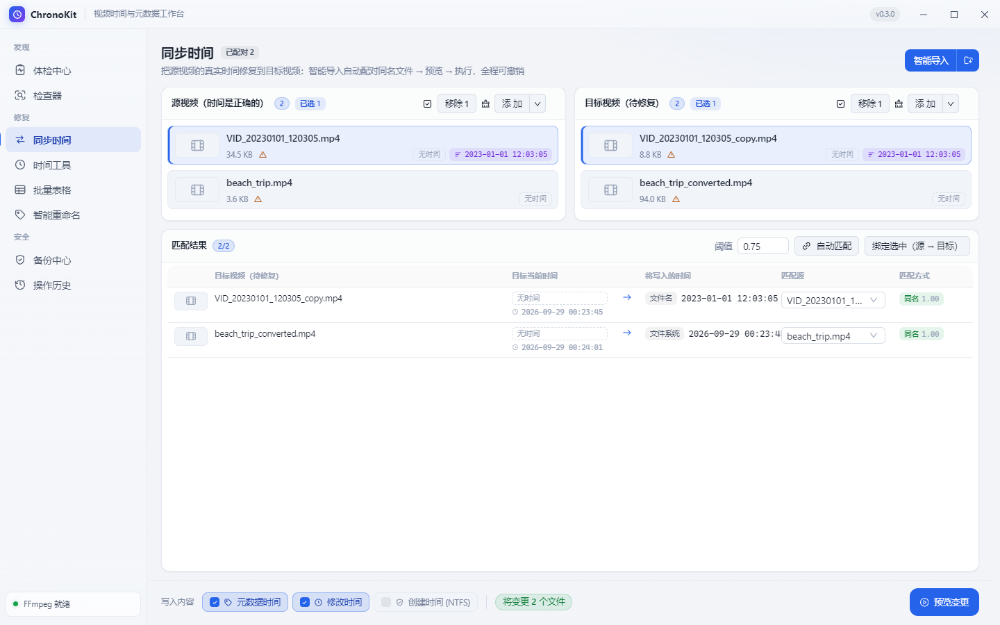
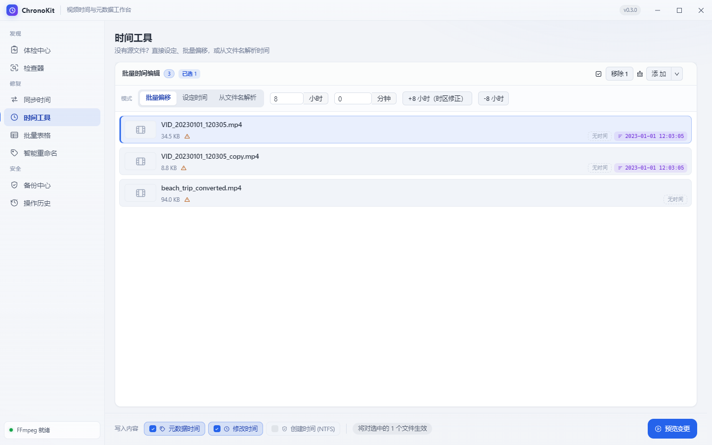
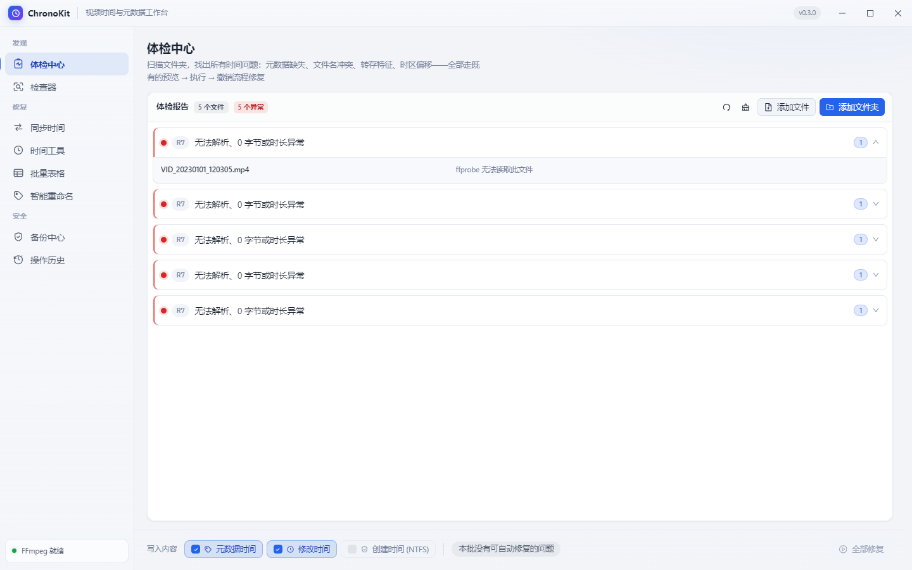

<div align="center">


# ChronoKit

**Open-source video timestamps & metadata toolbox**

Inspect, fix and batch-edit *time* on your videos and photos — container metadata,
file modification time, NTFS creation time — with dry-run preview, centralized
backup and full undo.

[](https://github.com/lanyunyanaaa/chronokit/actions/workflows/ci.yml)
[](./LICENSE)
[](#download)
[](https://www.electronjs.org/)

English | [简体中文](README.zh-CN.md)

</div>

> **100% local.** No account, no telemetry, no cloud. Your files never leave your machine.

## Why ChronoKit?

Re-encoding, transferring or "cleaning" a video often strips its real creation
time — the file looks like it was born the day it was copied. ChronoKit reads
the *true* time from a source file (container metadata, filename patterns or
filesystem timestamps), writes it back to the targets, and keeps every step
reversible: preview first, automatic backup, one-click undo.

## Features

| Tool | What it does |
| --- | --- |
| **Sync Time** | Copy the real timestamp from a source video to target videos. Smart matching pairs originals with re-encoded copies (exact name → fuzzy name → size → duration), with manual rebinding. |
| **Time Tools** | Set an absolute time, apply batch offsets (e.g. `+8h` timezone fix), or parse times from filenames (`VID_…`, `IMG_…`, `Screenshot_…`, `mmexport…` and more). |
| **Inspector** | See what's really inside: container `creation_time`, filesystem mtime/ctime, EXIF capture time for photos. |
| **Batch Table** | Spreadsheet-style bulk editing — set values, shift a column, copy between columns, with virtualized rendering for large batches. |
| **Smart Rename** | Rename media files from timestamps with three templates and conflict strategies — fully undoable. |
| **Checkup Center** | A rule engine that scans your library for time problems and fixes them with one click. |
| **Backup Center** | Every write is backed up per operation. Restore a single file or browse by batch. |
| **Operation History** | A persistent journal — undo any write, even after restarting the app. |

**What gets written**

- Videos: container metadata `creation_time` (via ffmpeg remux), filesystem mtime/ctime.
- Photos (JPEG/PNG): EXIF capture time is *read*; writes touch filesystem times only —
  photo container metadata is never rewritten (safe by design until EXIF write lands).

## Download

Grab the latest installer from the [**Releases**](https://github.com/lanyunyanaaa/chronokit/releases) page:

| File | Type |
| --- | --- |
| `ChronoKit Setup x.x.exe` | Windows installer (NSIS) |
| `ChronoKit x.x.exe` | Portable — single executable, no install |

- Bundled ffmpeg — no extra installation needed. You can also point `CK_FFMPEG_DIR`
  to a custom ffmpeg directory.
- The binaries are not code-signed yet. If Windows SmartScreen asks, choose
  **More info → Run anyway**.

<div align="center">
  
  <p><sub>Sync Time — pair sources and targets, preview the plan, execute.</sub></p>
</div>

## Three steps to start

1. **Add files** — drag a folder or files onto any page (or click *Add*). Smart import
   recursively scans and pairs "original / re-encoded" copies by name.
2. **Pick a tool** — sync from a source, or edit times directly (absolute, offset,
   filename parsing).
3. **Preview, then execute** — every write starts as a dry-run comparison table.
   Writes are journaled and backed up; undo is one click away, even after a restart.

<div align="center">
  &nbsp;
  
  <p><sub>Time Tools · Checkup Center</sub></p>
</div>

## Development

Prerequisites: **Node.js ≥ 20** and **pnpm 9**. Windows is required for packaging.

```bash
pnpm install
pnpm dev           # run the app
pnpm test          # vitest unit tests (core logic)
pnpm typecheck     # TypeScript checks (node + web)
pnpm icons         # regenerate icon.ico/png from build/icon.svg
pnpm ffmpeg:fetch  # place ffmpeg/ffprobe into resources/ffmpeg (PATH copy or LGPL download)
pnpm dist          # build Windows installer + portable (electron-builder)
```

ffmpeg/ffprobe resolution order: `CK_FFMPEG_DIR` env var → bundled
`resources/ffmpeg` → system `PATH`. `pnpm dist` fetches ffmpeg automatically and
a `beforePack` hook verifies the binaries.

### Project layout

```
src/core/       Pure TypeScript domain logic (planning, matching, EXIF, rename…) + unit tests
src/main/       Electron main-process services (journal, backups, media probe, session)
src/renderer/   React + antd UI (pages, stores, design system)
docs/           Roadmap, UI design system, screenshots
```

## Roadmap

See [docs/ROADMAP.md](docs/ROADMAP.md). Highlights ahead:

- **U2b** — EXIF *write* for photos (JPEG first), with the same preview/backup/undo guarantees
- **U3** — auto-update, macOS/Linux builds, CLI

## Contributing

Contributions are welcome! Read [CONTRIBUTING.md](CONTRIBUTING.md) for setup and
conventions, and check the [roadmap](docs/ROADMAP.md) for good starting points.

## Security

Found a vulnerability? Please report it privately — see [SECURITY.md](SECURITY.md).

## License

[MIT](./LICENSE) © ChronoKit contributors.
The bundled ffmpeg is an LGPL-licensed build; it is a separate program and does
not change the license of ChronoKit itself.
